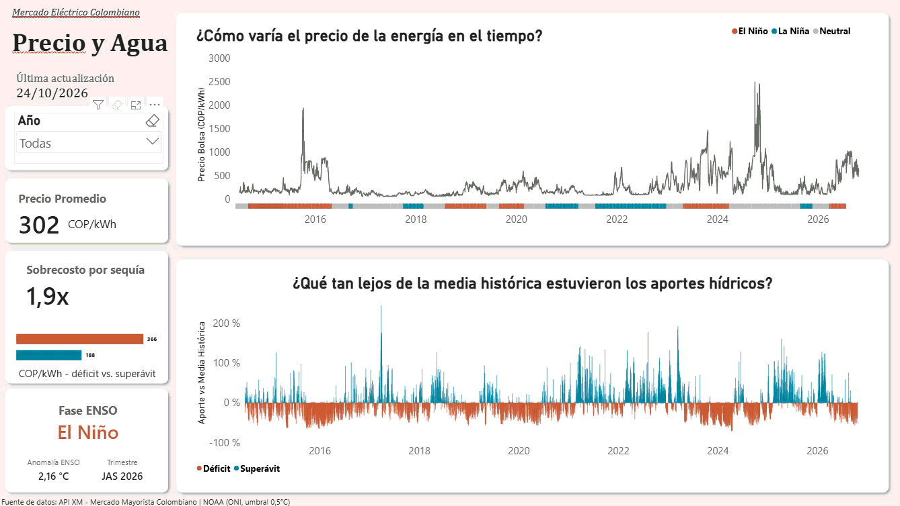
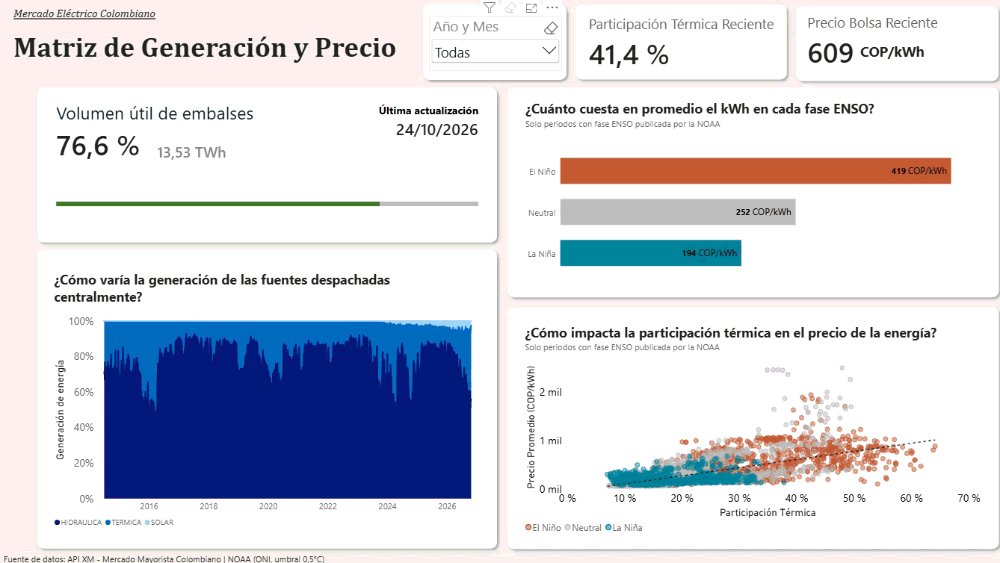
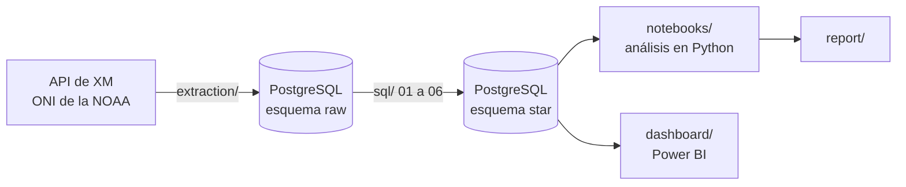
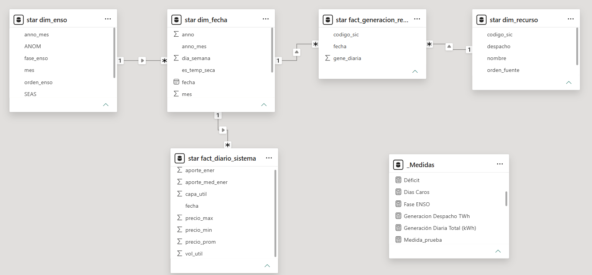

# Riesgo de precio en temporada seca. Mercado eléctrico colombiano

Proyecto de análisis de datos sobre el precio de bolsa de la energía en Colombia. Descarga desde mediados del 2014 hasta la actualidad datos públicos de XM y de la NOAA, los organiza en un modelo estrella en PostgreSQL, los analiza en Python y los presenta en dos tableros de Power BI.

**Pregunta.** ¿Qué mueve el precio de bolsa en Colombia cuando falta el agua?

**Respuesta corta.** Los aportes de los ríos y la generación térmica pesan más que el volumen de los embalses. La correlación del precio con la participación térmica es +0,66, y con el volumen útil apenas −0,17.

Las cifras de este README tienen fecha de corte. Se calcularon con datos diarios del 1 de julio de 2014 al 24 de octubre de 2026 (4.499 días).

## Hallazgos clave

- **Sobrecosto por sequía de 1,9×.** Los días con aportes bajo la media histórica tienen un precio promedio de 366 COP/kWh, frente a 188 en los días con superávit.
- **El Niño encarece la energía 2,2 veces frente a La Niña.** El precio promedio es de 419 COP/kWh en El Niño, 252 en fase neutral y 194 en La Niña.
- **La hidrología del mismo día explica solo el 16 % del precio.** En una regresión lineal (OLS), casi todo ese 16 % viene de los aportes. Cada punto porcentual de aporte por debajo de la media histórica se asocia con unos 2,8 COP/kWh más, con el volumen constante.
- **La térmica marca los días caros.** Al dividir los días en cuartiles de precio, la participación térmica pasa del 12,6 % al 32,3 % y el precio se multiplica por 7. El salto más grande ocurre entre el tercer y el cuarto cuartil.
- **El récord no llegó con El Niño.** El precio diario más alto (2.499 COP/kWh, 30 de septiembre de 2024) ocurrió durante la fase neutral, el día después de que la CREG activara el Estatuto de Desabastecimiento. Se conserva en los datos como un atípico de origen regulatorio.

El resumen ejecutivo para el sector energético está en [report/reporte.md](report/reporte.md).

## Tableros de Power BI

**Precio y Agua.** Precio de bolsa con la cinta de fases ENSO, aportes en déficit o superávit, tarjetas de resumen y un tooltip con la generación por fuente.



**Matriz de Generación y Precio.** Generación por fuente al 100 %, precio por fase ENSO, dispersión entre participación térmica y precio con línea de tendencia, y volumen útil de los embalses.



Capturas estáticas en [dashboard/Captura_Precio_Aporte.png](dashboard/Captura_Precio_Aporte.png) y [dashboard/Captura_Matriz_Gene.png](dashboard/Captura_Matriz_Gene.png).

## Herramientas

| Etapa | Herramientas |
|---|---|
| Extracción | Python, pydataxm (API de XM), pandas, SQLAlchemy |
| Almacenamiento y transformación | PostgreSQL, SQL (CTE, funciones de ventana, `DISTINCT ON`, `generate_series`) |
| Análisis | pandas, statsmodels, matplotlib, seaborn |
| Visualización | Power BI (DAX, Power Query) |

## Pipeline

El proyecto sigue un esquema ELT. Los datos se extraen, se cargan sin cambios a un esquema `raw` y se transforman dentro de PostgreSQL.



1. **Extracción** (`extraction/extraer_datos.ipynb`). Descarga de XM el precio de bolsa horario, la generación por planta, los aportes hídricos y su media histórica, el volumen y la capacidad útil de los embalses, la capacidad efectiva neta por planta y el listado de recursos. Descarga de la NOAA el índice ONI, que clasifica cada mes como El Niño, La Niña o Neutral teniendo en cuenta un umbral de ±0,5 °C. Carga diez tablas al esquema `raw`.
2. **Transformación** (`sql/`). Seis scripts que se corren en orden y reconstruyen el esquema `star` desde `raw`.
3. **Análisis** (`notebooks/analisis_datos.ipynb`). Controles de calidad, series de tiempo, correlaciones, regresión, fases ENSO y cuartiles de precio.
4. **Visualización** (`dashboard/`). Dos tableros de Power BI conectados al esquema `star` desde PostgreSQL.

## Modelo de datos

| Tabla | Grano | Filas |
|---|---|---|
| `dim_fecha` | Un día, con la marca de temporada seca (diciembre a marzo) | 4.499 |
| `dim_recurso` | Una planta, con su tipo de fuente y categoría de despacho | 2.491 |
| `dim_enso` | Un mes, con su anomalía ONI y su fase | 920 |
| `fact_diario_sistema` | Un día del sistema (precio promedio, máximo y mínimo, aportes, volumen) | 4.499 |
| `fact_generacion_recurso` | Una planta en un día | 948.634 |
| `fact_capacidad_recurso` | La capacidad efectiva neta de una planta en un día | 1.994.976 |



Modelo en Power BI. `dim_enso` se relaciona con `dim_fecha` por año y mes, como un copo de nieve. `fact_capacidad_recurso` queda en PostgreSQL para análisis futuros del factor de planta y no se carga en los tableros.

## Decisiones técnicas

- **Aporte relativo frente a la media histórica.** Se compara el aporte de cada día contra su media histórica, en lugar de usar el valor en bruto. Su correlación con el precio es más fuerte (−0,39 frente a −0,28).
- **Descarga por años.** Con doce años de una sola vez, la consulta de capacidad efectiva neta daba `TimeoutError`, porque pydataxm lanza todas las peticiones mensuales al mismo tiempo. Se descarga año por año y se une con `pandas.concat`.
- **Capacidad en su propia tabla.** Más de la mitad de las filas de capacidad no tiene generación ese día, como las térmicas en reserva. Como columna de la tabla de generación se habrían perdido.
- **Duplicados de origen.** XM entrega algunas filas repetidas de capacidad. Se resuelven con `DISTINCT ON` y, si hay dos valores, se conserva el mayor.
- **Meses sin fase ENSO.** La NOAA publica con unos dos meses de retraso, ya que debe tener en cuenta el trimestre transcurrido. Esos meses se excluyen de los análisis por fase.
- **pandas menor que 3.0.** La versión 3 es incompatible con pydataxm.

## Limitaciones

- El análisis muestra asociaciones, no causas.
- La regresión usa solo la hidrología del mismo día y explica el 16 % del precio. Sus errores están autocorrelacionados (Durbin-Watson de 0,13), así que los p-valores son optimistas. Los residuos no son normales, por los picos de precio.
- Quedan por fuera el precio del gas, la demanda y la latencia entre la sequía y la subida del precio.
- Los días con precio administrado, como el 30 de septiembre de 2024, se conservan sin corregir.
- XM publica con unos tres días de retraso y los últimos días de cada descarga son provisionales.

## Estructura del repositorio

```
riesgo_precio_temporada_seca/
├── extraction/
│   └── extraer_datos.ipynb       Descarga de XM y NOAA, carga a raw
├── sql/
│   ├── 01_dim_recurso.sql        Crea el esquema star
│   ├── 02_dim_fecha.sql
│   ├── 03_dim_enso.sql
│   ├── 04_fact_diario_sistema.sql
│   ├── 05_fact_generacion_recurso.sql
│   └── 06_fact_capacidad_recurso.sql
├── notebooks/
│   └── analisis_datos.ipynb      Análisis y regresión
├── dashboard/
│   ├── Tablero_Datos_XM.pbix
│   ├── Tablero_Precio_AporteEne.gif
│   ├── Tablero_Matriz_Gene.gif
│   ├── Captura_Precio_Aporte.png
│   ├── Captura_Matriz_Gene.png
│   └── Modelo_Datos_PowerBI.png
├── report/
│   ├── reporte.md                Resumen ejecutivo
│   └── images/
├── requirements.txt
├── .env.example
└── .gitignore
```

## Cómo reproducirlo

Se necesita Python y PostgreSQL instalados.

1. Crear un entorno virtual e instalar las dependencias con `pip install -r requirements.txt`.
2. Crear en PostgreSQL una base de datos llamada `mercado_energia`. Los notebooks se conectan con el usuario `postgres` en `localhost:5432`.
3. Copiar `.env.example` como `.env` y escribir ahí la contraseña de PostgreSQL.
4. Correr `extraction/extraer_datos.ipynb`. La descarga completa es larga y llega hasta el último domingo transcurrido.
5. Correr los scripts de `sql/` en orden, del 01 al 06.
6. Correr `notebooks/analisis_datos.ipynb`.
7. El archivo `.pbix` se abre con los datos ya importados. Para actualizarlo hay que conectarlo a la base local.

## Fuentes

- XM, operador del Sistema Interconectado Nacional, mediante la librería [pydataxm](https://pypi.org/project/pydataxm/).
- NOAA, Climate Prediction Center, [índice ONI](https://www.cpc.ncep.noaa.gov/data/indices/oni.ascii.txt).

## Autor

Alexander Garzón Losik · [LinkedIn](https://www.linkedin.com/in/alexandergarzonl)
