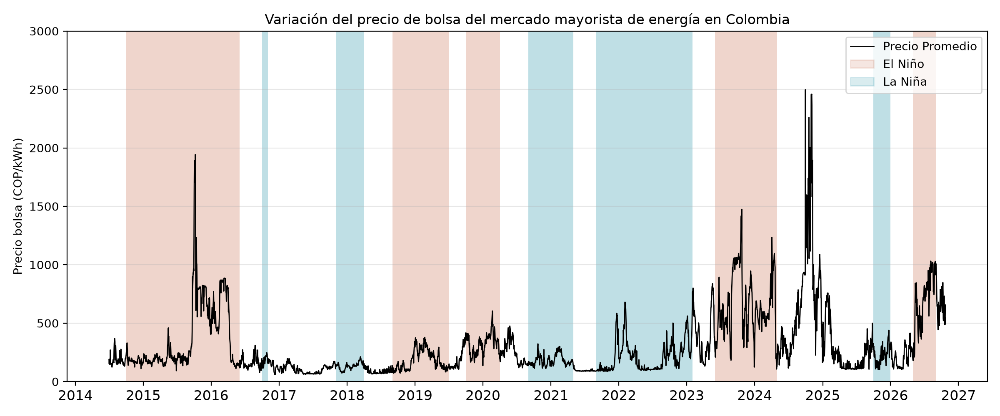

# Report - What drives the spot price in Colombia when water is scarce?
River inflows and thermal generation matter more than reservoir volume. The statistical correlation between the price and the thermal share is +0.66, while with usable reservoir volume it is only -0.17.
___

**DATA:** Spot price, generation by plant, hydro inflows and reservoir volume from XM, downloaded from its public API with pydataxm. ENSO phases from NOAA (ONI index). Daily data from July 1, 2014 to October 24, 2026 (4,499 days). Comparisons by phase use only the months already published by NOAA.
___

In 2006 the Energy and Gas Regulatory Commission (CREG) created the Reliability Charge (Cargo por Confiabilidad), a capacity remuneration mechanism based on firm energy, to guarantee the availability of firm energy in the electricity system, especially under water stress or during events that directly affect the country's hydroelectric production. Thermal generation has provided backup to the electricity system. In extreme cases, thermal plants must generate 52% of the energy required when hydrological inflows are low, as was seen mainly during the 2015-2016 El Niño event ([ACOLGEN](https://acolgen.org.co/wp-content/uploads/2022/04/ACOLGEN_ANALISIS-DE-LA-EVOLUCION-DEL-CARGO-POR-CONFIABILIDAD.pdf)). In addition, during the period analyzed, the thermal share exceeded 51.5% of generation on only 1% of days, in line with the 52% reported by ACOLGEN.

The spot price of the Colombian wholesale market is well known for its high volatility, due to the large share of hydropower in the country's generation resources. The figure below shows how the price varied from mid-2014 to October 2026 (the date of this report).

*Daily average spot price of the Colombian wholesale energy market (COP/kWh). Red bands mark El Niño and blue bands mark La Niña. The chart labels are in Spanish.*

- Within this period there is, on average, an important difference between the price during El Niño and during La Niña, at 419 and 194 COP/kWh, respectively. In other words, a kWh costs on average 2.2x more during El Niño.
- Comparing the relative inflow, defined as (energy inflow - historical mean)/historical mean, with the energy price shows a 1.9x premium (366 COP/kWh with an inflow deficit versus 188 COP/kWh with an inflow surplus).
- Same-day hydrology (inflows and usable volume) explains only 16% of the variation in the price, mostly through inflows. Each percentage point of inflow below the historical mean is associated with about 2.8 COP/kWh more in the price, holding volume constant.
- It is worth noting that the highest daily average price in the period analyzed occurred in a neutral phase, at close to 2,500 COP/kWh, just after the 2023-2024 El Niño. This can be explained in part by a 20% deficit in river inflows, a usable reservoir volume of around 50% and thermal generation of close to 45%. *Note: September 30, 2024 was an atypical day of regulatory origin. It coincides with CREG's 2014 Shortage Statute (Estatuto de Desabastecimiento), activated the day before ([Asuntos Legales](https://www.asuntoslegales.com.co/analisis/valeria-rodriguez-martinez-4012085/de-la-teoria-a-la-practica-la-verdadera-cara-del-estatuto-de-desabastecimiento-de-energia-electrica-4012083)).*

The results presented in this portfolio show that, although usable volume gives an overall picture of the hydrological situation of the electricity system, it is not enough to explain price volatility. The spot price is more sensitive to energy inflows from rivers and also to the share of thermal plants, which depend heavily on fuel prices (gas and coal). The table below shows that a 2.6-fold increase in the average thermal share coincides with a price that is 7 times higher on average.

| Price Quartile | Average Price (COP/kWh) | Average Thermal Share |
| ----------- | ----------- | ----------- |
| Q1 | 99.1  | 12.6% |
| Q2 | 158.7 | 18.7% |
| Q3 | 260.4 | 21.3% |
| Q4 | 688.1 | 32.3% |

___
***Limits:** This analysis shows associations, not causes. The regression uses only same-day hydrology and explains 16% of the price. Gas prices, demand and the lag between drought and price are left out, and days with an administered price, such as September 30, 2024, were left uncorrected.*
