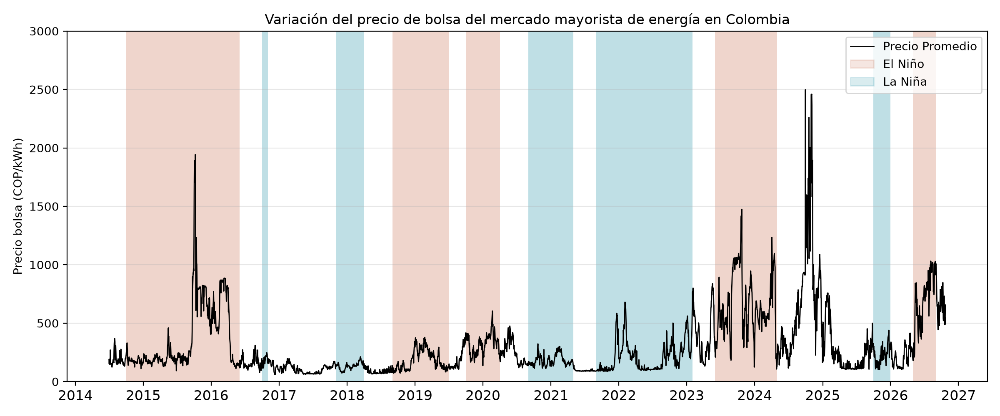

# Reporte - ¿Qué mueve el precio de bolsa en Colombia cuando falta el agua?
Los aportes de los ríos y la generación térmica tienen más preponderancia que el volumen de los embalses. La correlación estadística del precio con la participación térmica es de +0,66 mientras que con el volumen útil es de apenas -0,17.
___

**DATOS:** Precio de bolsa, generación por planta, aportes hídricos y volumen de embalses de XM, descargados de su API pública con pydataxm. Fases ENSO de la NOAA (índice ONI). Datos diarios del 1 de julio de 2014 al 24 de octubre de 2026 (4.499 días). Las comparaciones por fase usan solo los meses que la NOAA ya publicó.
___

En el año 2006 la Comisión de Regulación de Energía y Gas (CREG) crea el Cargo por Confiabilidad con el fin de garantizar la disponibilidad de energía firme en el sistema eléctrico, especialmente en situaciones de estrés hídrico o durante fenómenos que impacten directamente la producción hidroeléctrica del país. La generación térmica ha ofrecido un respaldo al sistema eléctrico, donde en casos extremos las plantas térmicas deben generar el 52% de la energía que se requiere en situaciones de bajos aportes hidrológicos, esto se vio principalmente evidenciado durante el Fenómeno de El Niño en 2015-2016 ([acolgen](https://acolgen.org.co/wp-content/uploads/2022/04/ACOLGEN_ANALISIS-DE-LA-EVOLUCION-DEL-CARGO-POR-CONFIABILIDAD.pdf)). Además, en el periodo analizado, la térmica superó el 51,5% de la generación solo el 1% de los días, alineado con el 52% reportado por ACOLGEN.

Es bien sabido que el precio de bolsa del mercado mayorista colombiano tiende a ser muy volátil debido al alto componente hidráulico de los recursos de generación del país. La gráfica a continuación muestra cómo varía el precio dentro de un periodo de mediados de 2014 hasta octubre del 2026 (fecha de realización de este reporte).

- Dentro de ese periodo existe en promedio una variación importante entre el precio durante el fenómeno de El Niño y de La Niña, con 419 y 194 COP/kWh, respectivamente. Es decir, el sobrecosto del kWh durante el fenómeno de El Niño es 2,2x en promedio.
- Comparando el aporte relativo, que corresponde a (aporte en energía - media histórica)/media histórica, con el precio de la energía se constata un sobrecosto de 1,9x (366 COP/kWh en déficit de aportes frente a 188 COP/kWh en superávit).
- La hidrología del mismo día (aportes y volumen útil) explica solo el 16 % de la variación del precio, con una predominancia de los aportes. Cada punto porcentual de aporte por debajo de la media histórica se asocia con unos 2,8 COP/kWh más en el precio, con el volumen constante.
- Es importante resaltar que el precio diario promedio más alto registrado dentro del periodo analizado se encontró en fase neutral con un valor de cerca de 2500 COP/kWh, justo después del fenómeno de El Niño de 2023-2024. Esto puede ser explicado en parte por un déficit en los aportes de los caudales de 20%, un volumen útil de embalses de alrededor del 50% y una generación térmica de cerca del 45%. *Nota: El 30 de septiembre del 2024 fue un día atípico de origen regulatorio que coincide con el Estatuto de Desabastecimiento del 2014 de la CREG,  activado el día anterior ([Asuntos Legales](https://www.asuntoslegales.com.co/analisis/valeria-rodriguez-martinez-4012085/de-la-teoria-a-la-practica-la-verdadera-cara-del-estatuto-de-desabastecimiento-de-energia-electrica-4012083))*

Los resultados presentados dentro de este portafolio permiten evidenciar que si bien el volumen útil da una idea global de la situación hidrológica del sistema eléctrico, su valor no es suficiente para explicar la volatilidad del precio. El precio "*spot*" es más sensible a los aportes en energía de los caudales y adicionalmente a la participación de las plantas térmicas, altamente dependientes del precio del combustible (gas y carbón). La tabla a continuación muestra que un aumento de un factor de 2,6 en la participación térmica promedio coincide con un precio 7 veces más caro en promedio.

| Cuartil de Precio | Precio Promedio (COP/kWh) | Participación térmica promedio |
| ----------- | ----------- | ----------- |
| Q1 | 99,1  | 12,6% |
| Q2 | 158,7 | 18,7% |
| Q3 | 260,4 | 21,3% |
| Q4 | 688,1 | 32,3% |

___
***Límites:** Este análisis muestra asociaciones, no causas. La regresión usa solo la hidrología del mismo día y explica el 16 % del precio. Quedan por fuera el precio del gas, la demanda y la latencia entre la sequía y el precio, y los días con precio administrado, como el 30 de septiembre de 2024, se dejaron sin corregir.* 